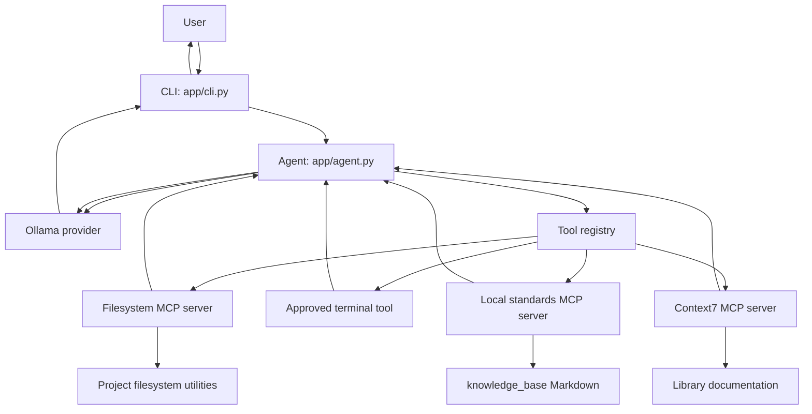

# CodingAssistant

CodingAssistant is a command-line coding assistant built around a local Ollama language model. It can inspect and edit files in the project, run a small set of approved development commands, retrieve the project's Python coding standards, and look up programming documentation through Context7.

## Features

- Conversational coding help using Ollama and the `qwen2.5-coder:7b` model by default.
- Tool calling for file reading, writing, listing, searching, and targeted edits.
- A filesystem MCP server that confines file access to the project and excludes common secret and generated-file locations.
- A restricted terminal tool for commands such as `pwd`, `ls`, `git status`, `git diff`, and `pytest`.
- Local coding-standard retrieval from Markdown files under `knowledge_base/`.
- Context7 documentation lookup for library-specific programming questions.
- A provider interface with Ollama and Groq implementations.

## Architecture



The CLI builds a `ToolRegistry` and passes it, together with an `OllamaProvider`, to the `Agent`. On each turn, the agent sends the conversation and registered tool definitions to the model. If the model requests a tool, the agent validates and executes it, appends the result to the conversation, and asks the model to continue. The loop is capped at 10 iterations.

The local filesystem and coding-standards MCP servers are started over stdio when called. Context7 is also launched over stdio using `npx` and `@upstash/context7-mcp`. The coding-standards retriever ranks Markdown sections by keyword overlap; it does not currently use embeddings or a vector database.

## Technology Stack

- **Python 3.10+** for the CLI, agent, providers, and tools.
- **Ollama** for local model inference (`qwen2.5-coder:7b` by default).
- **Model Context Protocol (MCP)** Python SDK for local stdio MCP clients and servers.
- **Context7 MCP** (`@upstash/context7-mcp`) for external library documentation.
- **Requests** for the Ollama HTTP API.
- **Groq Python SDK** for the optional Groq provider implementation.
- **POML** and a `.poml` template are included for prompt-building; the current coding-standards MCP server retrieves and returns context directly.
- **pytest** for automated tests.

## Requirements

- Python 3.10 or newer.
- Ollama installed and running locally.
- Node.js and npm available on `PATH` for Context7 lookups. Context7 is only needed when using documentation lookup.
- Internet access when using Context7 or installing Python packages.

## Setup

Run these commands from the repository root:

```bash
python3 -m venv .venv
source .venv/bin/activate
python -m pip install --upgrade pip
python -m pip install -r requirements.txt
python -m pip install mcp pytest
ollama pull qwen2.5-coder:7b
```

The application imports the MCP SDK, but `mcp` is not currently listed in `requirements.txt`, so it is installed separately above. `pytest` is included as a development/test dependency in the command because it is needed to run the test suite.

Start Ollama if it is not already running. On systems where the Ollama service is not started automatically, run:

```bash
ollama serve
```

Keep that process running, then open another terminal in the repository root and launch the assistant:

```bash
python -m app.cli
```

Enter a prompt at `You:`. Type `exit` to quit. The CLI currently uses Ollama directly; the Groq provider exists in `app/providers/groq.py` but is not selected by the CLI. Using Groq would require wiring that provider into the CLI and setting `GROQ_API_KEY`.

## Example Prompts

```text
List the Python files in this project.
Search the project for TODO comments.
Read test_workspace/greeting.py and explain what it does.
What naming conventions does this project follow?
Look up the current pytest documentation for parametrized tests.
```

The assistant is expected to use the coding-standards tool for questions about this project's conventions and Context7 for library documentation questions.

## Tools

| Tool | Purpose |
| --- | --- |
| `read_file` | Read a project text file. |
| `write_file` | Create or overwrite a project text file. |
| `list_files` | List files and directories under the project root. |
| `search_in_files` | Search project files for matching text. |
| `edit_file` | Replace one unique text occurrence in a file. |
| `run_command` | Run commands permitted by the terminal allowlist. |
| `search_coding_standards` | Retrieve relevant sections from local coding standards. |
| `resolve_library_id` | Find a Context7 library ID before requesting documentation. |
| `query_docs` | Retrieve documentation for a previously resolved Context7 library ID. |
| `add_numbers` | Demonstration tool that adds two integers. |

Filesystem operations reject paths outside the project root and block `.env` files, virtual environments, Git metadata, common generated directories, and `.pem`/`.key` files. The terminal tool does not invoke a shell and accepts only a limited set of development commands; it is not a general-purpose command runner.

## Tests

Run the test suite from the repository root with the virtual environment activated:

```bash
python -m pytest
```

Tests cover the agent, provider behavior, filesystem and terminal tools, MCP adapters, and example project functions. Some integration paths may need network access or configured local services; check individual test modules for their specific requirements.

## Project Structure

```text
app/
	agent.py                 LLM/tool orchestration loop
	cli.py                   CLI entry point and tool registration
	providers/               Ollama and Groq provider adapters
	tools/                   Tool registry, filesystem utilities, terminal allowlist
	mcp/                     MCP clients, servers, Context7 adapter, and RAG
knowledge_base/             Local standards documents used by retrieval
test_workspace/             Small example files for assistant tasks
tests/                      Additional test directory
requirements.txt            Python package requirements
run.py                      Empty placeholder; use app.cli as the entry point
```

## Configuration Notes

- The CLI constructs `OllamaProvider()` with model `qwen2.5-coder:7b` and base URL `http://localhost:11434`.
- To change the Ollama model or endpoint, update the provider construction in `app/cli.py` or its defaults in `app/providers/ollama.py`.
- `GROQ_API_KEY` is required only if the Groq provider is wired into the application.
- Run the CLI from the repository root. The local MCP client and filesystem utilities use the current working directory as the project root.
- `run.py` is currently empty; launch the app with `python -m app.cli`.
